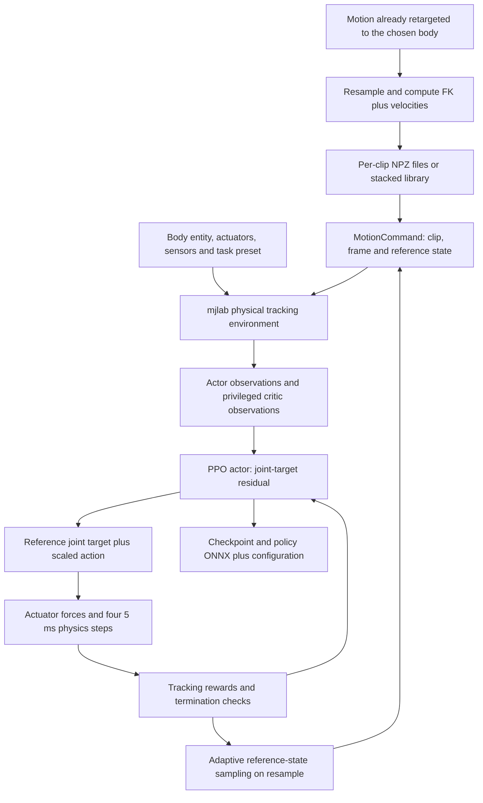

# WBC-mjlab: imitation pipeline code audit

Audit date: **18 October 2026**. This report follows the implementation through source code, rather than treating the README's advertised capabilities as measured results for our human.

## Conclusion

**WBC-mjlab provides a complete reference-motion imitation training pipeline on mjlab.** It prepares multi-clip motion libraries, builds a physical tracking environment, supplies motion-conditioned observations and tracking rewards, samples difficult reference states, and trains an actor/critic through mjlab and RSL-RL PPO. The default G1 task already uses **5 ms physics, four physics steps per actor update, and reference-relative residual joint-position actions**.

The NumPy constraint was a dependency reconciliation issue, not evidence that WBC could not be used. We did not previously complete an installation/integration test or compare its learning performance against our custom tracker. This source audit strengthens the case for trying a small WBC human extension before expanding our own imitation infrastructure.

The implementation also makes important distinctions visible: multi-clip training does not establish physically continuous combinations; conversion is forward kinematics rather than proof of dynamic feasibility; the default training preset permits external assistance; generic tracking rewards do not implement our punching contract.

## Revisions and scope

| Source | Revision | Inspection |
|---|---|---|
| Current WBC main downloaded for this audit | `eb6c024b9586bc1de41b3dd22b9f18ad51cb1da9` (17 October 2026) | Training, registration, motion conversion/loading, command stepping, observations/actions, rewards/terminations, sampling, assistance, G1/custom robot wiring, export |
| WBC revision named by the Task 09 plan | `689f0836dc795cb7f2b7bda13dee0236c3383643` | Eleven selected files retrieved and compared with current source |
| Our accepted mjlab source | `8ee51fbcf806a7419189f706d9e394cbeb7790fa` | Training launcher and environment stepping inspected to follow delegation |

The eleven-file comparison found identical training entry point, runner, G1 PPO configuration, G1 base wiring, base environment, actions, assistive-wrench implementation, default WBC preset, and extension API. `commands.py` adds optional reference-position grounding in current source; `pyproject.toml` adds Studio dependencies/entry point. Therefore residual control, 5/20 ms clocks, assistance, and the reset-based clip boundary behavior described below are also present in the inspected plan revision. This is a selected-file comparison, not a claim that both complete repositories are identical.

The downloaded checkout is in `.cache/deps/wbc-mjlab-audit/`; selected plan-revision files and their comparison manifest are in `.cache/deps/wbc-mjlab-plan-689f0836/`. Neither is a project runtime dependency yet. This was **source inspection only**: no WBC installation, task construction, GPU smoke test, training, or performance benchmark was performed. `robust_sav` and sibling mjlab were not edited; no Git staging/commit/push was performed.

All WBC source links below are pinned to the audited current revision.

## 1. Pipeline and ownership

WBC supplies the tracking task and orchestration; mjlab supplies the manager-based environment, GPU physics interface, training launcher, and RSL-RL integration; RSL-RL supplies PPO updates. WBC does not implement a second independent physics engine or a completely separate PPO trainer.

## 2. Body registration and task selection

[`extension.py`](https://github.com/wbc-mjlab/wbc-mjlab/blob/eb6c024b9586bc1de41b3dd22b9f18ad51cb1da9/src/wbc_mjlab/extension.py#L18-L86) exposes `WbcRobotSpec` and `register_wbc_extension`. An extension registers the body identifier, environment builder, PPO configuration builder, optional motion-conversion metadata, data root, optional symmetry rules, and tasks. A biological human can use that interface even though the API calls every controlled character a “robot.” WBC does not require that character to have G1's skeleton or joint count.

[`tasks/__init__.py`](https://github.com/wbc-mjlab/wbc-mjlab/blob/eb6c024b9586bc1de41b3dd22b9f18ad51cb1da9/src/wbc_mjlab/tasks/__init__.py#L97-L110) registers each task's train environment, play environment, RL configuration, and `PolicyOnlyMotionTrackingRunner` with mjlab. For G1, [`robots/g1/tasks.py`](https://github.com/wbc-mjlab/wbc-mjlab/blob/eb6c024b9586bc1de41b3dd22b9f18ad51cb1da9/src/wbc_mjlab/robots/g1/tasks.py#L27-L34) builds the body-specific base and applies a preset such as WBC, Zest, binary-failure sampling, end-effector observations, or state-estimation observations.

The newer `robots/custom.py` also offers MJCF/URDF import and generic task construction. That is useful scaffolding, but its automatic gains/actuator choices are not qualification of our human. In particular, its generic path constructs `IdealPdActuatorCfg`; our successful human relies on a specifically bounded native implicit PD law. We must preserve or deliberately compare that law rather than assume an automatic import reproduces the accepted controller.

## 3. Motion preparation: retarget first, then convert

[`motion/motion_formats.py`](https://github.com/wbc-mjlab/wbc-mjlab/blob/eb6c024b9586bc1de41b3dd22b9f18ad51cb1da9/src/wbc_mjlab/motion/motion_formats.py) reads CSV or GMR-style PKL containing root position, root quaternion, and joint coordinates. The joint coordinates must already describe the selected body's articulation; this converter does not solve DuoBox-to-human IK. Named columns can be reordered, but a mismatched DOF count fails validation in `motion/robot_assets.py::resolve_dof_joint_names`.

The source loader interpolates root translation/joint coordinates, uses quaternion SLERP, and derives velocities. [`motion/data_to_npz.py::run_sim_pool`](https://github.com/wbc-mjlab/wbc-mjlab/blob/eb6c024b9586bc1de41b3dd22b9f18ad51cb1da9/src/wbc_mjlab/motion/data_to_npz.py#L195-L335) writes reference root/joint states, calls `sim.forward()`, and logs body kinematics. **This stage is kinematic FK, not torque-driven execution.** Optional mirroring and sole-height debiasing augment the data preparation.

| Converted NPZ field | Shape | Role |
|---|---|---|
| `fps` | Scalar/list containing rate | Export rate; converter defaults to 50 Hz |
| `joint_pos`, `joint_vel` | T × J | Body-specific joint positions and velocities |
| `body_pos_w` | T × B × 3 | World body-link positions |
| `body_quat_w` | T × B × 4 | World body-link orientations |
| `body_lin_vel_w`, `body_ang_vel_w` | T × B × 3 | World body-link velocities |
| Bundle segment starts/lengths/names | One record per clip | Preserve clip identity in a concatenated library |

Two adapter details require care:

- Source CSV/PKL root quaternions are **xyzw**, but `_raw_clip_to_input_tensors` explicitly converts them to **wxyz** before simulation. The NPZ writer copies mjlab's `body_link_quat_w` directly. The source documentation's assertion that converted `body_quat_w` is xyzw conflicts with that code path; an adapter should use the actual mjlab convention and an FK round-trip check, not copy the table's claim.
- Training `MotionLoader` loads frames, and `MotionCommand` advances one frame per environment step. It does not resample from the NPZ `fps` field during training. A 20 ms actor clock therefore needs a 50 Hz library. Changing the physics/decimation without preparing the matching reference rate changes playback timing.

Our existing retargeted references remain useful, but their archive schema is different. We need an explicit adapter preserving root/joint order, frame transforms, glove attachment, velocity conventions, and committed timing. We do not need to redo retargeting merely to change PPO infrastructure.

## 4. Multi-clip motion command and initialization

[`env/mdp/commands.py::MotionLoader`](https://github.com/wbc-mjlab/wbc-mjlab/blob/eb6c024b9586bc1de41b3dd22b9f18ad51cb1da9/src/wbc_mjlab/env/mdp/commands.py#L61-L192) accepts a dataset directory of clips or a stacked bundle, moves arrays to device tensors, and retains segment boundaries. `MotionCommand` owns per-world trajectory IDs and frame indices, exposes reference joint/body state, computes tracking metrics, and aligns relative body poses for tracking.

Reference-state initialization (RSI) chooses a clip and a frame at which to start training. `_resample_command` adds configured pose/velocity/joint perturbations and writes that state into the physical simulation. This is intentional training initialization. After initialization, actions and physics generate the motion.

There is a second use of that same reset path that matters for us: [`_update_command`](https://github.com/wbc-mjlab/wbc-mjlab/blob/eb6c024b9586bc1de41b3dd22b9f18ad51cb1da9/src/wbc_mjlab/env/mdp/commands.py#L893-L921) calls `_resample_command` when a clip ends; that method calls `_write_reference_state_to_sim`. **Clip changes can therefore rewrite physical root/joint state.** A policy trained on many clips is not automatically a controller demonstrated to switch punches without resetting.

For our use, a launch/handoff mechanism must change the reference while preserving physical state, establish the next reference's coordinate alignment, and train/evaluate the transition. Guard-start acceptance must additionally avoid random mid-punch initialization. The built-in `sampling_mode="start"` selects the first trajectory's first frame; it is not by itself a complete per-family evaluation bank.

## 5. Actor/critic observations and actions

[`env/wbc_env_cfg.py`](https://github.com/wbc-mjlab/wbc-mjlab/blob/eb6c024b9586bc1de41b3dd22b9f18ad51cb1da9/src/wbc_mjlab/env/wbc_env_cfg.py#L96-L269) constructs separate actor and critic observation groups.

- **Default WBC actor:** current reference base height, base linear/angular velocity, reference gravity direction, reference joint positions; measured base angular velocity, projected gravity, relative joint positions/velocities, and previous action. `apply_wbc` removes reference joint velocity from the actor and sets history length to one. This default is a current-reference tracker, not our existing future-target-window layout.
- **Critic:** noiseless actor features plus privileged body poses/velocities, anchor errors, reference accelerations, contact information, assistance values, segment phase, and tracking-reward features. The critic assists training and is not needed for actor inference.
- **Variants:** the SE preset changes actor state information; the EE preset conditions the actor on end-effector reference features instead of joint-reference terms. These are task configurations, not evidence of arbitrary target/TTC capability in our application.

[`ReferenceJointPositionAction`](https://github.com/wbc-mjlab/wbc-mjlab/blob/eb6c024b9586bc1de41b3dd22b9f18ad51cb1da9/src/wbc_mjlab/env/mdp/actions.py#L23-L64) implements

\[
q_{\mathrm{target}}=q_{\mathrm{reference}}+S a-\text{encoder bias}.
\]

The actor's action is therefore already a **residual joint-target correction**, conceptually similar to our current tracker. The entity's actuators turn targets into physical joint forces. WBC's G1 actuator configuration includes robot-specific PD gains, torque-speed envelopes, and friction; those G1 actuator assumptions must not be copied onto the human.

This is **reinforcement learning for motion imitation**: reference kinematics define observations/rewards, and PPO learns actions through simulated interaction. It is not supervised behavior cloning of motion-capture motor commands; such commands are not supplied by the motion dataset.

## 6. Rewards, termination, and adaptive sampling

[`presets/wbc.py`](https://github.com/wbc-mjlab/wbc-mjlab/blob/eb6c024b9586bc1de41b3dd22b9f18ad51cb1da9/src/wbc_mjlab/presets/wbc.py#L17-L120) sets tracking rewards for root/anchor position and orientation, root velocity, relative keybody positions/orientations, joint position, and body velocity. Kernels in `env/mdp/rewards.py` have the form `exp(-kappa * squared_error / std**2)`. Additional terms penalize action changes, joint acceleration, joint-limit proximity, and actuator effort near its configured limit, alongside a survival reward. Some available terms are disabled in this preset: for example foot-slip weight is zero. Merely finding a reward function in the repository does not mean it is active.

The default WBC preset sets an anchor-height error cutoff of 0.35 m, end-effector **height** error cutoff of 0.25 m, projected-gravity mismatch termination, and a 2,000 N keybody-ground-force cutoff, plus the episode timeout. These are generic tracking/failure criteria. They do not certify our glove-center precision, return-to-guard dwell, head-contact timing, or complete-cycle success. In particular, the default end-effector cutoff is not a 3D glove-target accuracy test.

[`sampling.py`](https://github.com/wbc-mjlab/wbc-mjlab/blob/eb6c024b9586bc1de41b3dd22b9f18ad51cb1da9/src/wbc_mjlab/env/mdp/sampling.py#L233-L320) maintains per-clip/time-bin difficulty estimates. The WBC preset derives similarity from active tracking rewards, updates an exponential moving average of difficulty, then samples harder bins more frequently while keeping 15% uniform sampling. Its bin width is four seconds and its minimum-bin-span ratio is 0.5. Those defaults should be reconsidered for our short, event-focused punch cycles. A binary-failure preset is also available.

## 7. External-assistance curriculum: explicit and removable

The WBC training preset enables `assistive_wrench_enabled`. `MotionCommand::_set_episode_assist_gain` computes a per-episode gain from estimated difficulty (bounded by 0.6); enabling the feature does not imply every episode receives nonzero assistance. [`AssistiveWrenchEvent`](https://github.com/wbc-mjlab/wbc-mjlab/blob/eb6c024b9586bc1de41b3dd22b9f18ad51cb1da9/src/wbc_mjlab/env/mdp/assistive_wrench.py#L62-L152) can write an external force and torque to the anchor body to help follow the reference. This differs from our internal support-feedforward calculation, which only contributes to capped joint torques.

This is a training curriculum choice, not a reason to reject WBC. The [G1 play builder](https://github.com/wbc-mjlab/wbc-mjlab/blob/eb6c024b9586bc1de41b3dd22b9f18ad51cb1da9/src/wbc_mjlab/robots/g1/tasks.py#L180-L191) already disables the assistance flag and event, actor corruption, and interval pushes. It does not replace our independent full-cycle evaluation or automatically remove clip-boundary state writes.

For an initial fair human comparison, disable assistance during both training and evaluation to preserve our existing unassisted contract. Alternatively, a deliberately documented assisted pretraining experiment is possible, followed by unassisted fine-tuning and acceptance. Any accepted result must explicitly measure zero external assistance.

## 8. Training clock, PPO, and export

[`scripts/train.py::main`](https://github.com/wbc-mjlab/wbc-mjlab/blob/eb6c024b9586bc1de41b3dd22b9f18ad51cb1da9/src/wbc_mjlab/scripts/train.py#L99-L123) resolves the task/library, sets logging, and delegates to `mjlab.scripts.train.main`. Task registration selects `PolicyOnlyMotionTrackingRunner`, which inherits mjlab's tracking runner. In our pinned mjlab source the launcher constructs `ManagerBasedRlEnv`, wraps it for RSL-RL, constructs the registered runner, and calls `runner.learn()`.

The [base environment](https://github.com/wbc-mjlab/wbc-mjlab/blob/eb6c024b9586bc1de41b3dd22b9f18ad51cb1da9/src/wbc_mjlab/env/wbc_env_cfg.py#L465-L489) sets `timestep=0.005`, `decimation=4`, 8,192 parallel environments, and a ten-second episode. Thus its configured actor/environment period is 20 ms. This is a simulation update period, not measured inference latency. The G1 actuator's configurable command-delay feature is disabled by default. A different body's 5 ms stability still requires testing; our human's native implicit PD implementation cannot be assumed equivalent to its G1 actuator path.

[`robots/g1/rl_cfg.py`](https://github.com/wbc-mjlab/wbc-mjlab/blob/eb6c024b9586bc1de41b3dd22b9f18ad51cb1da9/src/wbc_mjlab/robots/g1/rl_cfg.py#L10-L46) supplies these defaults, all configurable:

| PPO setting | Default |
|---|---|
| Actor hidden layers | 1024, 512, 256, 128; ELU; observation normalization |
| Critic hidden layers | 1024, 1024, 512, 256; ELU; observation normalization |
| Rollout length per environment | 24 actor steps = 0.48 s at the default clock |
| Learning epochs / minibatches | 5 / 4 |
| Learning rate / schedule | 0.001 / adaptive |
| PPO clip / discount / GAE lambda | 0.2 / 0.99 / 0.95 |
| Checkpoint interval / iteration ceiling | 250 / 200,000 |

A rollout buffer need not span an entire punch for PPO to train on it; environments can continue across PPO updates. These large generic defaults are not a compute estimate or recommended budget for our four clips.

[`rl/runner.py`](https://github.com/wbc-mjlab/wbc-mjlab/blob/eb6c024b9586bc1de41b3dd22b9f18ad51cb1da9/src/wbc_mjlab/rl/runner.py#L51-L200) saves checkpoints and exports actor plus observation normalizer to a policy-only ONNX graph. Reference clips remain external, rather than being embedded in a large graph. Exports include joint/action/observation metadata and configuration; optional RSI statistics restore the sampling curriculum. ONNX/export failures are caught with warnings while training continues, so checkpoint existence alone does not establish a successful portable export.

## 9. What can transfer to human-punching?

| Capability | WBC already supplies | Work still needed for us |
|---|---|---|
| One tracker across clips | Motion library, shared actor, RSI/PPO | Train/evaluate all four families; sufficient variation and balancing |
| Our 48-coordinate body | External body/task registration | Correct entity, sensors, body maps, bounded native PD, gains and contact rules |
| Existing retargeted punches | Body-specific motion conversion infrastructure | Explicit archive adapter, exact FK/order checks, 50 Hz reference rate |
| 5/20 ms clock | Already default in audited base task | Actual human stability and shared G1 solver qualification |
| Precise head-directed punching | Extensible rewards/observations | Glove-center sites, target variants, orientation/precision losses and our acceptance gates |
| Requested TTC | Reference-following infrastructure | Feasible timing variants, launch semantics, conditioning and timing checks |
| Continuous mixed punches | Shared network can read different references | Replace reset-based switching with state-preserving handoffs and train transitions |
| Launch-target commitment | Externally supplied reference is compatible with it | Snapshot head target and freeze attack plan in environment-owned logic |
| Tactical adversary | Low-level tracker can be a component | Scheduler/game objective, legality, protagonist integration and evaluation |

An arbitrary human MJCF is not a pretrained G1/SOMA policy. We can keep the constrained SOMA23 derivative while using WBC's training framework; switching frameworks does not require switching to the original 66-coordinate SOMA asset. Existing custom PPO checkpoints have a different network/observation/control contract and should remain comparison baselines rather than being treated as direct WBC checkpoints.

## 10. Recommended bounded integration experiment

1. **Resolve an isolated environment.** Select a WBC revision, pin our accepted mjlab source, use a compatible NumPy below 2.5, and test imports/task registration before training. The inspected current lock resolves mjlab 1.6.0, MuJoCo/MuJoCo-Warp 3.11.0 and Warp 1.14.0, but RSL-RL 5.4.2 and platform-specific Torch versions differ from our accepted environment. The package's broad version bounds do not prove compatibility with our exact source pin. Keep `robust_sav` unchanged.
2. **Register the current human and convert one accepted jab.** Preserve physical properties and the bounded implicit controller. Verify names, quaternion order, sole/glove FK, reference rate, one-step forces, quiet standing, and actual 5 ms integration.
3. **Compare one jab first.** Disable assistance, retain our independent guard-start trial bank and complete-cycle gates, and use a comparable training budget. Report actual results against the frozen specialist. This isolates framework feasibility before adding harder generalization.
4. **Train a shared four-clip actor.** Keep per-family evaluation and a balanced sampler. Then add state-preserving guard handoffs and continuous mixed sequences. Do not count reset-based library playback as a combination result.
5. **Extend targets/timing and shared G1 simulation.** Reuse our reference builder, contact definitions, target commitment, and release audit. These task-specific pieces are still needed with either training framework.

The decision criterion should be measured learning quality, compatibility, and maintainability. The earlier NumPy mismatch is insufficient grounds for choosing a custom imitation stack; conversely, this source audit alone is insufficient grounds to declare WBC integrated or superior.

## 11. PPO iteration counts compared with our actual checkpoints

An iteration collects a fresh rollout and then runs several minibatch optimization steps. It is separate from the actor's 50 Hz inference rate. Comparing iteration labels alone hides the rollout batch size and earlier training inherited by our selected checkpoints.

| Quantity | Audited WBC G1 defaults | Our selected human training runs |
|---|---:|---:|
| Parallel environments | 8,192 | 128 |
| Actor steps per environment per iteration | 24 | 64 |
| Fresh transitions per iteration | **196,608** | **8,192** |
| Epochs over each collected batch | 5 | Up to 4 |
| Minibatches per epoch | 4 | 4 (size 2,048) |
| Minibatch optimization steps per iteration | 20 configured | Up to 16; later runs can stop early on KL |
| Run budget | 200,000-iteration default ceiling | Budgets in the selected ancestry range from 200 to 800 per stage; selected checkpoints can precede the end of a run |

One default WBC iteration collects **24 times** the fresh data of one of ours. Its minibatch size is 49,152 transitions, compared with 2,048 in ours. At its full configured ceiling WBC would collect **39,321,600,000 policy transitions**. This is an arithmetic consequence of defaults, not an observed WBC run, a convergence requirement, or a recommended budget for four punches. We have not run WBC training.

Tracing `arguments.json` initialization paths and `training.jsonl` through the selected checkpoint in each stage gives:

| Released policy | Selected final-stage iteration | Final-stage minibatch optimization steps | Iterations along complete weight ancestry | Transitions along that ancestry |
|---|---:|---:|---:|---:|
| Jab | 100 | 1,527 | **800** | **6,553,600** |
| Cross | 100 | 1,272 | **1,600** | **13,107,200** |
| Left hook | 300 | 4,583 | **1,500** | **12,288,000** |
| Right hook | 100 | 1,401 | **1,600** | **13,107,200** |

The ancestry is the actual sequence of weight transfers leading to the released checkpoint:

- Shared initial jab: original 2 ms run `5895253` through update 200, then 5 ms run `5931617` through update 400.
- Jab: shared initial jab → `5931681` through 100 → `5931736` through 100.
- Cross: shared initial jab → `5931664` through 200 → `5931706` through 400 → `5931781` through 300 → `5931870` through 100.
- Left hook: shared initial jab → `5931707` through 600 → `5931834` through 300.
- Right hook: shared initial jab → `5931708` through 600 → `5931833` through 300 → `5931884` through 100.

Thus “selected at update 100” does **not** mean learned from scratch in 100 iterations. Later `--initialize-policy` stages reset the optimizer/update counter but retain weights. The ancestor data include earlier jab training, changed references/rewards, and the original 2 ms phase. These totals count learning transitions on the path to each selected policy; they exclude evaluation, discarded branches, and training after the selected checkpoint. Shared ancestors overlap, so summing the four totals would double-count work. They are not an inventory of total research compute.

The final-stage optimizer counts above come directly from the logs. Across complete ancestry the corresponding counts are 12,727 / 24,758 / 23,257 / 24,745 for jab / cross / left / right. Older logs lack an explicit optimizer-step field; their counts are reconstructed from the frozen trainer's unconditional epoch/minibatch loop and recorded arguments, while newer counts include logged KL early stopping. Detailed local arithmetic and ancestry records are saved in `.cache/wbc-ppo-budget-comparison.json`.

Sources: [WBC PPO defaults](https://github.com/wbc-mjlab/wbc-mjlab/blob/eb6c024b9586bc1de41b3dd22b9f18ad51cb1da9/src/wbc_mjlab/robots/g1/rl_cfg.py#L28-L45), [WBC environment count](https://github.com/wbc-mjlab/wbc-mjlab/blob/eb6c024b9586bc1de41b3dd22b9f18ad51cb1da9/src/wbc_mjlab/env/wbc_env_cfg.py#L465-L488), [our training loop](../src/human_punching/jab_learning.py), [release manifest](../outputs/four-punch-milestone/manifest.json), and [original jab milestone](../outputs/jab-milestone/README.md).

These budgets address different scopes: WBC defaults target broad motion-library tracking; our releases address one conditioned reference per specialist with tiny initial perturbations. The count comparison establishes training scale, not relative sample efficiency or generalization quality.
